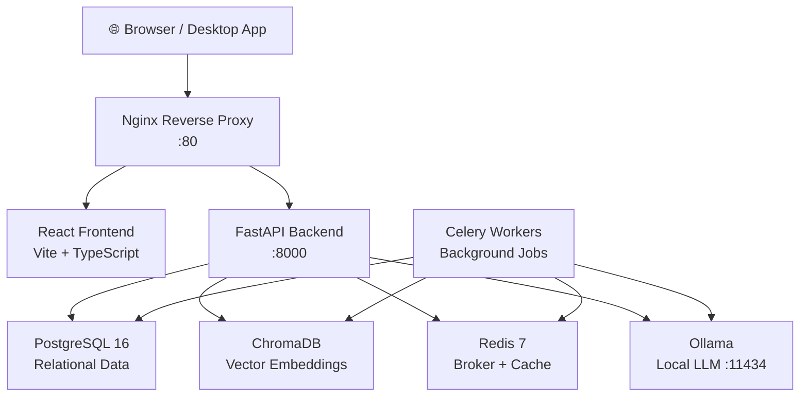
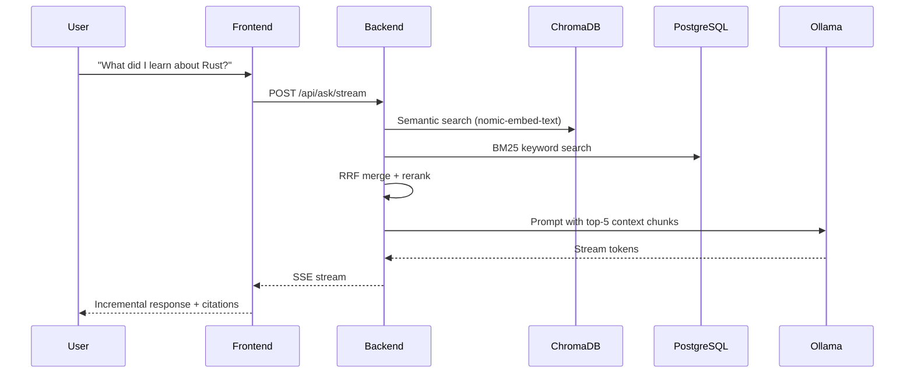

# Architecture Overview

## Service Architecture

## Component Breakdown

### Backend (FastAPI)

| Module | Purpose |
|--------|---------|
| `app/routers/notes.py` | Note CRUD, search, versioning, AI assist |
| `app/routers/ask.py` | RAG chat, SSE streaming |
| `app/routers/search.py` | Hybrid search (BM25 + semantic) |
| `app/routers/ingest.py` | File upload pipeline |
| `app/routers/import_.py` | URL/YouTube import |
| `app/routers/flashcards.py` | Flashcard generation + SM-2 scheduling |
| `app/routers/analytics.py` | Knowledge base statistics |
| `app/routers/digest.py` | Daily AI digest |
| `app/routers/garden.py` | Public garden + RSS |
| `app/routers/auth.py` | JWT auth (single-user / multi-user) |
| `app/services/search_service.py` | Hybrid BM25 + ChromaDB RRF search |
| `app/services/rag_service.py` | RAG context building + LLM chat |
| `app/services/embedding_service.py` | ChromaDB embedding management |
| `app/llm/router.py` | Multi-provider LLM routing + fallbacks |

### Frontend (React)

| Page | Route |
|------|-------|
| Dashboard | `/` |
| Notes List | `/notes` |
| Note Editor | `/notes/new`, `/notes/:id` |
| Ask Brain | `/ask` |
| Knowledge Graph | `/graph` |
| Flashcards | `/flashcards` |
| Analytics | `/analytics` |
| Review | `/review` |
| Settings | `/settings` |

### Data Flow: RAG Chat

## Security Architecture

- All services on a private Docker network — only Nginx exposed
- Ollama, Postgres, Redis, ChromaDB: **not reachable from outside**
- SSRF protection on URL import (IP range validation + DNS rebinding defence)
- Input sanitisation on all LLM prompts (prompt injection defence)
- JWT access tokens (30 min) + refresh tokens (7 days) in `httpOnly` cookies
- CSRF double-submit cookies
- CSP, `X-Frame-Options`, `X-Content-Type-Options` headers

