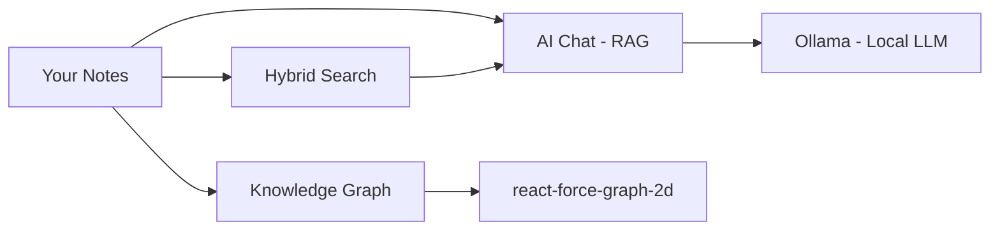

# 🧠 Second Brain

**An open-source, local-first, AI-powered Personal Knowledge Management system.**

> All AI runs locally via [Ollama](https://ollama.com/). No telemetry. No cloud calls. No vendor lock-in.

---

## ✨ What is Second Brain?

Second Brain is a privacy-first PKM app for developers, researchers, and knowledge workers who want to **own their data and their AI**.



## 🚀 Quick Start

=== "Docker (Recommended)"
    ```bash
    git clone https://github.com/your-username/AI-Personal-Knowledge.git
    cd AI-Personal-Knowledge
    cp .env.example .env
    docker compose up -d
    # Open http://localhost
    ```

=== "Manual"
    ```bash
    # Backend
    cd backend && pip install -r requirements.txt
    uvicorn app.main:app --reload

    # Frontend (new terminal)
    cd frontend && npm install && npm run dev
    ```

## ✅ Core Features

| Feature | Status |
|---------|--------|
| AI Chat (RAG) with source citations | ✅ |
| Hybrid search (BM25 + semantic) | ✅ |
| YouTube transcript import | ✅ |
| Web page import (SSRF-protected) | ✅ |
| File import (PDF, DOCX, PPTX, TXT, MD) | ✅ |
| Interactive knowledge graph | ✅ |
| Spaced repetition (SM-2) | ✅ |
| AI flashcard generation | ✅ |
| Note versioning | ✅ |
| Public digital garden | ✅ |
| Analytics dashboard | ✅ |
| Daily digest | ✅ |
| Multi-user auth (JWT cookies) | ✅ |
| Multi-provider LLM (Ollama, OpenAI, Anthropic, Google) | ✅ |
| Browser extension (Chrome MV3) | ✅ |
| Tauri desktop app | ✅ |
| Obsidian vault export | ✅ |
